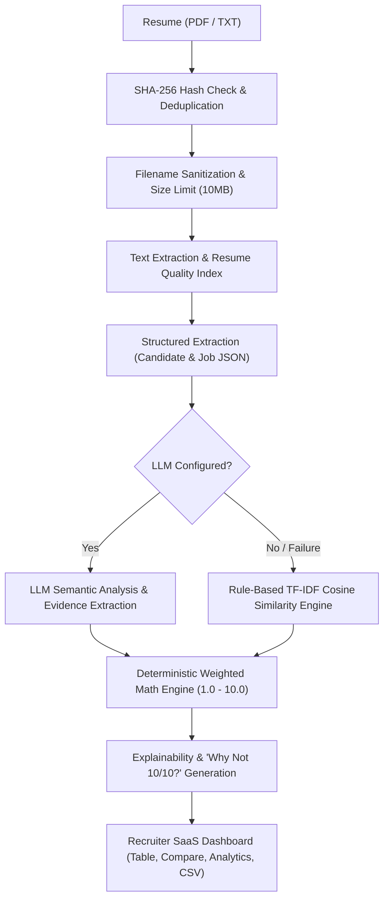

# SmartResume AI — Smart Resume Screener & Recruitment Intelligence Platform

A production-quality **AI-powered Resume Screener & Recruitment Intelligence Platform** built with FastAPI, SQLite/PostgreSQL, React 19, Vite, TypeScript, and Tailwind CSS.

---

## 🎯 1. Problem & Solution

### The Problem
Traditional ATS platforms rely on rigid keyword matching, rejecting qualified candidates who express skills using alternative terminology (e.g., rejecting an applicant who built "RESTful APIs in Express and MongoDB" for a role specifying "Node.js backend experience"). At the same time, opaque black-box AI scores lack explainability, leaving recruiters without evidence-backed justification for hiring recommendations.

### The Solution: SmartResume AI
SmartResume AI solves this through a **Hybrid AI Architecture**:
- **Semantic Understanding**: Uses LLMs to recognize technological equivalence and contextual experience depth without keyword gaming.
- **Evidence-Based Grounding**: Quotes exact text snippets extracted directly from candidate resume text for every matched skill or gap—no hallucinated claims.
- **Deterministic Math Scoring**: The LLM does **not** pick the final score. A transparent, configurable weighted formula calculates the match score ($1.0\text{--}10.0$).
- **Explainable Recommendations**: Generates **"WHY NOT 10/10?"** diagnostic points detailing exact reasons for score reductions.

---

## 🏗️ 2. Architecture & Pipeline



---

## 🧮 3. Deterministic Scoring Methodology

The final candidate match score ($1.0\text{--}10.0$) is calculated mathematically using configurable component weights that are strictly normalized ($\sum w_i = 1.0$):

$$\text{Final Score} = w_{\text{skills}} S_{\text{skills}} + w_{\text{exp}} S_{\text{exp}} + w_{\text{semantic}} S_{\text{semantic}} + w_{\text{projects}} S_{\text{projects}} + w_{\text{edu}} S_{\text{edu}} + w_{\text{cert}} S_{\text{cert}}$$

### Default Configurable Weights:
1. **Skills Match Coverage ($S_{\text{skills}}$ — 35%)**:
   $$\text{Skills Score} = \frac{\text{Matched Required} \times 1.0 + \text{Matched Preferred} \times 0.5}{\text{Total Required} \times 1.0 + \text{Total Preferred} \times 0.5} \times 10.0$$
2. **Experience Alignment ($S_{\text{exp}}$ — 20%)**:
   - $\text{Candidate Exp} \ge \text{Required Exp}$: $9.0 + 0.5 \times (\text{Ratio} - 1.0)$ up to $10.0$.
   - $\text{Candidate Exp} < \text{Required Exp}$: $\max(2.0, \frac{\text{Candidate Exp}}{\text{Required Exp}} \times 9.0)$.
3. **Semantic Job Fit ($S_{\text{semantic}}$ — 20%)**: Contextual alignment evaluated via LLM assessment or TF-IDF cosine similarity in Fallback mode.
4. **Project Relevance ($S_{\text{projects}}$ — 15%)**: Overlap between candidate project descriptions and target technology stack.
5. **Education Fit ($S_{\text{edu}}$ — 5%)**: Alignment with target degree requirements.
6. **Certifications Fit ($S_{\text{cert}}$ — 5%)**: Alignment with target certification requirements.

> **Dynamic Weight Normalization**: Any custom weight values submitted by recruiters are automatically normalized ($w_i' = \frac{w_i}{\sum w_k}$ and $1.0 \le \text{Final Score} \le 10.0$), ensuring mathematical stability.

---

## 🔒 4. Security, Privacy & Reliability Hardening

- **CSV Formula Injection Mitigation**: All candidate exports sanitize cells starting with formula triggers (`=`, `+`, `-`, `@`, `\t`, `\r`) by prepending a single quote (`'`), preventing DDE formula execution in spreadsheet software.
- **Filename Sanitization**: Uploaded filenames are stripped of directory traversal sequences (`../`, `..\\`), control characters, and dangerous symbols before storage.
- **File Upload Guardrails**: Enforces a strict 10MB size limit and validates file extensions (`.pdf`, `.txt`). Corrupted, empty, or scanned image-only PDFs are safely caught with clean user-facing error notices.
- **CORS Configuration**: Configurable via `CORS_ORIGINS` environment variable with secure local development defaults, preventing insecure wildcard credential exposure.
- **Idempotent Demo Seeding**: Repeated calls to `/api/demo/load` safely recreate the presentation project without accumulating redundant demo records in the database.
- **Persistent Role-Specific Weights**: `PUT /api/projects/{project_id}/weights` persists custom weights to the database and automatically recalculates scores and rankings for existing candidates.

---

## 🛠️ 5. Tech Stack

- **Frontend**: React 19, Vite, TypeScript, Tailwind CSS, Lucide Icons, Recharts.
- **Backend**: Python 3.11, FastAPI, Pydantic v2, SQLAlchemy ORM, PyPDF, Scikit-Learn (TF-IDF), Pytest.
- **Database**: SQLite (Zero-config development) / PostgreSQL compatible (`DATABASE_URL`).
- **AI Integration**: OpenAI / OpenRouter HTTP Chat Completions abstraction layer.

---

## 🚀 6. Installation & Quick Start

### 1. Prerequisites
- Python 3.10+
- Node.js 18+ and npm

### 2. Start Backend Server
```bash
cd smart-resume-screener/backend
python -m uvicorn app.main:app --reload --port 8000
```
Backend will start on `http://127.0.0.1:8000`.

### 3. Start Frontend Dev Server
```bash
cd smart-resume-screener/frontend
npm run dev
```
Frontend will open on `http://localhost:5173`.

### 4. Run Automated Test Suite (26 Pytest Tests)
```bash
cd smart-resume-screener/backend
python -m pytest
```

---

## 🌐 7. API Reference

| Endpoint | Method | Description |
| :--- | :---: | :--- |
| `/api/projects` | `GET` / `POST` | List all projects or create a new screening project |
| `/api/projects/{id}` | `GET` | Get project detail with target job and candidate ranking |
| `/api/projects/{id}/weights` | `PUT` | Persist custom scoring weights and recalculate candidate rankings |
| `/api/jobs` | `POST` | Analyze and save job description (Required vs Preferred skills) |
| `/api/resumes/upload` | `POST` | Upload and parse multiple resumes (PDF/TXT) with SHA-256 deduplication |
| `/api/screening/{id}/run` | `POST` | Execute screening and scoring across all project candidates |
| `/api/candidates/{id}` | `GET` | Get detailed candidate inspector profile with score breakdown |
| `/api/candidates/{id}/status` | `POST` | Update candidate status (`SHORTLISTED`, `REJECTED`, `UNDER_REVIEW`) |
| `/api/candidates/{id}/notes` | `POST` | Record persistent recruiter interview notes |
| `/api/candidates/compare` | `POST` | Compare up to 3 candidates side-by-side with trade-off analysis |
| `/api/analytics/{id}` | `GET` | Aggregated project skill coverage and missing skill gaps |
| `/api/export/{id}/csv` | `GET` | Download sanitized CSV candidate screening report |
| `/api/demo/load` | `POST` | Seed calibrated demo project with 5 dynamic candidate profiles |

---

## 🎬 8. Evaluator Demo Flow

1. Open `http://localhost:5173` to view the **SmartResume AI Landing Page**.
2. Click **"TRY DEMO"** to automatically seed a "Senior Backend Software Engineer" project with 5 candidates.
3. Review the **AI-Extracted Job Analysis** displaying `REQUIRED` vs `PREFERRED` skills.
4. Inspect the dynamic ranking:
   - **Alex Rivera (8.0 — Strong Match)**: Senior Cloud Backend Engineer.
   - **Priya Sharma (7.5 — Consider)**: Backend Developer missing AWS cloud certifications.
   - **Marcus Chen (6.0 — Consider)**: Transferable Java/Spring background.
   - **Elena Rostova (5.3 — Low Match)**: Systems engineer with partial overlap.
   - **David Miller (3.6 — Low Match)**: Junior Web UI designer (mismatch).
5. Click **"Scoring Weights"** in the toolbar to adjust weights and click **"Save & Re-Score"** to see live ranking recalculations.
6. Select 2-3 candidates with checkboxes and click **"Compare (3/3)"** for side-by-side trade-off analysis.
7. Click **"Inspect"** on any candidate to view radial score wheels, quote evidence, and **"WHY NOT 10/10?"**.
8. Click **"Export CSV"** to download the sanitized candidate spreadsheet.

---

## 🛡️ 9. Ethics, Responsible AI & Limitations

- **Decision-Support Tool**: SmartResume AI generates decision-support signals to assist human recruiters and **should not replace human judgment**. The tool does not claim to eliminate human bias or make hiring decisions autonomously.
- **Fairness by Design**: Scoring explicitly excludes protected personal attributes including gender, race, age, religion, photos, marital status, and political affiliations.
- **Verifiable Evidence**: Every match quote originates directly from candidate text. Missing information is never treated as definitive proof of absence; candidates may possess skills not documented on their resume.
- **Single-User Architecture**: Multi-tenant authorization and role-based access control (RBAC) are not implemented in this version.
